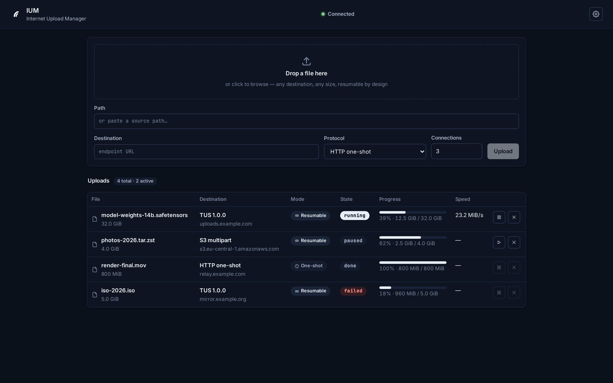
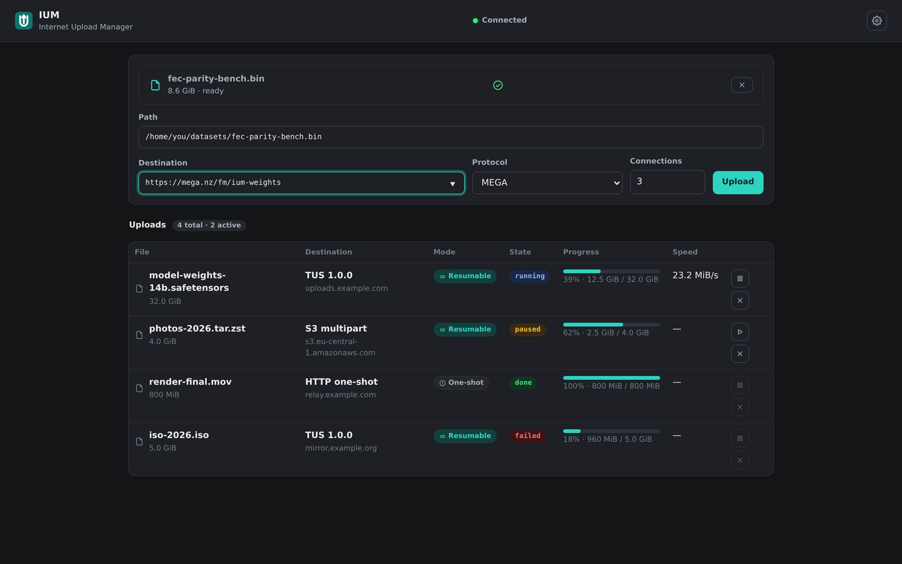
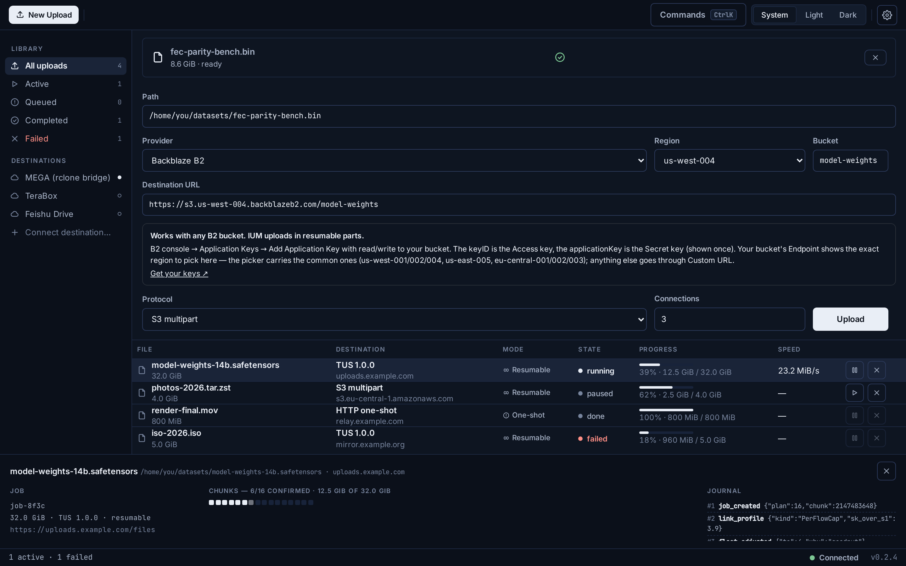
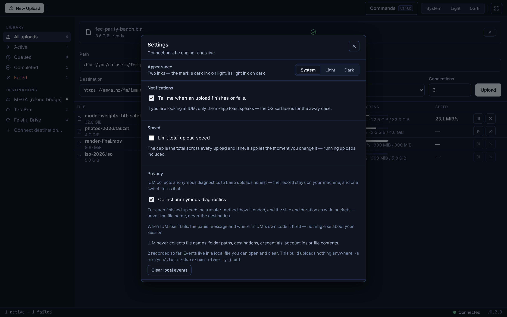
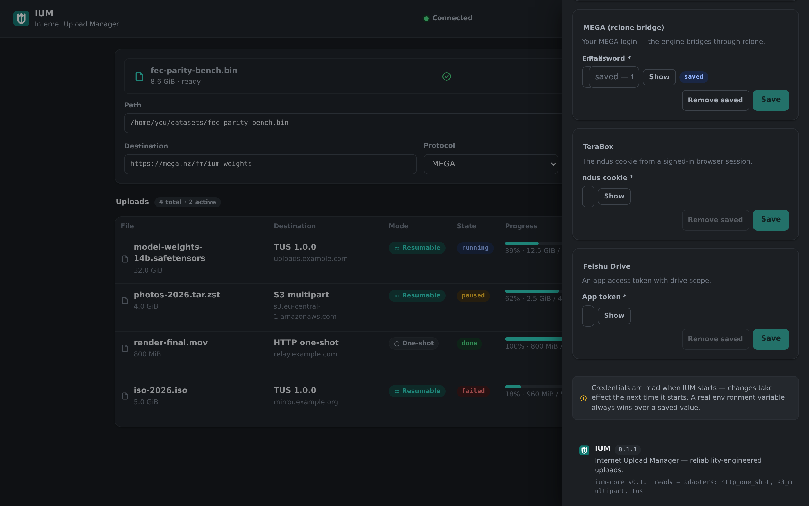
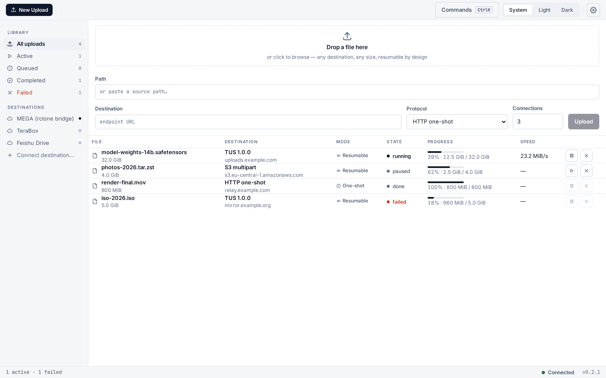

<div align="center">

<picture>
  <source media="(prefers-color-scheme: dark)" srcset="design/logo-white.svg" />
  
</picture>

# IUM — Internet Upload Manager

**The missing desktop twin of IDM / aria2 / Motrix / FDM — for uploads.**

Resumable, segmented, multi-protocol uploads that survive slow networks, sleep,
crashes and reboots — with *honest* badges where physics says a protocol cannot resume.


</div>

---

Every download manager solves *"a 5 GB file on a flaky 2 Mbps line"* — for **downloads**.
Uploads still get one fragile `POST` that dies at 90% and starts over. IUM applies twenty
years of download-manager engineering — chunk pools, adaptive split, slow-link eviction,
endgame racing, crash-safe journals — to the upload direction, and pairs it with a policy
the industry usually leaves implicit: **never claim what was not verified**.

IUM is a desktop app for Linux, macOS (Apple Silicon) and Windows. The upload engine is
built into the app — there is no service to install, no config file to write.

## Screenshots

The shipped shell in the **Ink** design language, captured from the running product —
dark first, because that is the default scheme. The four-pane anatomy: a command toolbar,
a library/destinations sidebar, the dense work list, and a status bar — with a docked
inspector and a centered settings modal.

| | |
|---|---|
|  |  |
|  |  |
|  |  |

Every progress percent you see is journal truth — a paused, done or failed row shows
what the journal confirmed, not a guess. A one-shot destination says **One-shot ⚠**
instead of pretending it can resume.

## Highlights

| | |
|---|---|
| **Crash-safe by construction** | A write-ahead journal is the only source of truth. State is read from it, never guessed — kill the app mid-transfer and the upload resumes byte-exact with zero re-confirmed bytes. Pinned nightly by real kill-and-resume drills. |
| **Verify-before-declare** | A job reaches Done only after the destination confirms the assembled object. Every failure carries its own written reason — never silence. |
| **Three real transports** | HTTP one-shot (streaming PUT), S3 multipart (any S3-compatible bucket), TUS 1.0.0 (byte-level resume). Plus bridges to WebDAV, Google Drive and YouTube, and vault lanes for TeraBox, Feishu and MEGA — connect the account, and the upload begins. |
| **Adaptive engine** | Dynamic chunk pool, slow-connection eviction voted on measured throughput, per-error-class retry budgets — every path ends in Done or Failed, never in a lie. |
| **Built for KB/s links** | A link prober measures the wire before committing and classifies the bottleneck; pieces shrink to fit the slowest legal moment; a locked destination is a wait, not a failure. |
| **A desktop-native face** | The **Ink** design language: first-class dark and light themes, one typography across all three OSes, keyboard-first command palette, OS notifications, a global speed cap, and WCAG AA contrast in both schemes. |
| **Privacy is a written stance** | Diagnostics stay in a local file you can open and clear, and this build has no sending code at all — nothing leaves the device by construction, not by promise. |

## Transports & honesty

| Destination | Protocol | Resume | Notes |
|---|---|---|---|
| HTTP | plain `PUT` | ⚠️ restart-from-zero | streaming from disk, ETag capture, server-side verify |
| S3-compatible | S3 multipart | ✅ per-part | Backblaze B2, Cloudflare R2, Wasabi, Scaleway, DigitalOcean Spaces, Filebase, MinIO — the form's provider picker builds the URL, keys set once in Settings |
| TUS 1.0.0 | TUS | ✅ byte-level | server-acked offsets, drifted uploads realign |
| WebDAV | WebDAV `PUT` | bridge-declared | connect with URL + username + password |
| Google Drive | Drive resumable | bridge-declared | one-click sign-in in your browser; the token stays in your OS keychain |
| YouTube | resumable upload API | ✅ byte-level | native sign-in with anti-CSRF protection; uploads are private by default |
| TeraBox · Feishu · MEGA | native bridges | bridge-declared | connect the account, the upload begins |

**You don't need to know what an endpoint URL is.** The upload form asks
"where should files go?" — pick a provider, name your bucket, and the
destination builds itself, with a deep link to the provider's key console
and a test button that checks your keys before the first job. A finished
upload can hand you a private, expiring share link. Anything else still
takes a pasted URL — power users lose nothing.

Where a server physically cannot resume, the UI says **One-shot ⚠️** instead of pretending.
The badge is derived from the destination's declared capabilities — never hard-coded.

## Download & install

Grab the current release from the [Releases page](https://github.com/kahlanhamza/IUM-dist/releases):

| Platform | File |
|---|---|
| Linux | `.deb` · `.rpm` · `.AppImage` |
| macOS (Apple Silicon) | `.dmg` |
| Windows | `.msi` · `.exe` |

Verify the checksum against the release's `SHA256SUMS.txt` — the [User Guide](USERGUIDE.md)
has the exact command for each OS. The installers are not code-signed yet; the first launch
may ask for one explicit confirmation (SmartScreen on Windows, Gatekeeper on macOS) — the
guide shows the step and the reason.

## Updates

IUM ships a built-in updater that reads the release feed and offers updates in place —
or download the new installer and install over the old one; your journal, credentials and
preferences carry over.

## Architecture

```
┌────────────────────────── the desktop shell ─────────────────────────────────┐
│  upload form · live job list · per-chunk inspector · settings & vault        │
└───────────────────────────────┬───────────────────────────────────────────────┘
                                │ typed IPC + live job events
┌───────────────────────────────▼───────────────────────────────────────────────┐
│  Supervisor  spawn / pause / resume / cancel — journal-truth state machine   │
├───────────────────────────────────────────────────────────────────────────────┤
│  Engine      chunk pool · leases · eviction · resplit · counted retries      │
├───────────────────────────────┬───────────────────────────────────────────────┤
│  Destination adapters        │  Session journal (write-ahead, crash-safe)     │
│  HTTP · S3 · TUS · bridges   │  every transition recorded before it executes  │
└───────────────────────────────┴───────────────────────────────────────────────┘
```

## How it is verified

- **Every push**: the full test suite (346 engine + 191 UI) on Linux, macOS and Windows;
  live wire rehearsals against four real server implementations; a real end-to-end drive
  of the desktop shell itself.
- **Nightly**: fuzzing at scale, kill-and-resume drills on the wire, and the dependency
  vulnerability gate.
- **On demand**: impairment benchmarks — packet loss, latency, mid-transfer resets,
  KB/s-class links — and long-haul soaks with resource-growth bounds.

## Help

Install problems, first-upload walkthrough, verification commands, and troubleshooting
live in the [User Guide](USERGUIDE.md). Notable changes per release are in
[CHANGELOG.md](CHANGELOG.md).

## Security

Report vulnerabilities privately via [GitHub security advisories](https://github.com/kahlanhamza/IUM/security/advisories/new)
rather than a public issue. Every release ships checksums (`SHA256SUMS.txt`) and a minisign
signature for each installer; the dependency tree is scanned for known vulnerabilities nightly.

---

*© 2026 IUM. All rights reserved. This software is proprietary; unlicensed use,
copying and distribution are not permitted. Versioning follows semver.*
